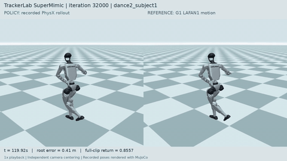
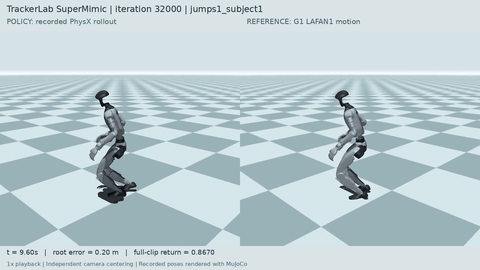
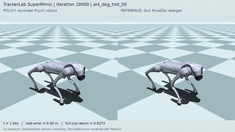
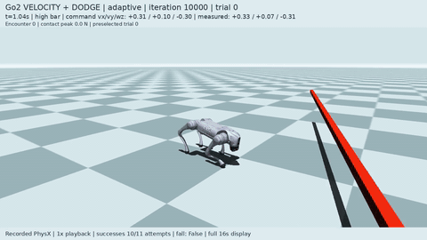
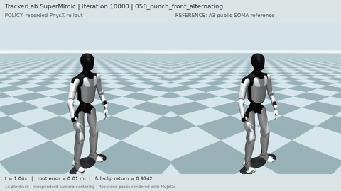
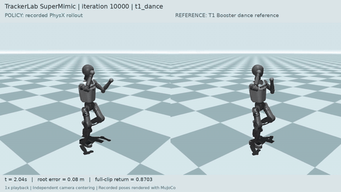
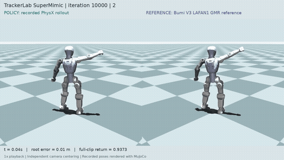
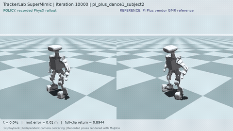

# TrackerLab SuperMimic

[中文说明](README_zh.md)

A focused implementation of TrackerLab's **G1, Go2, A3, T1, Bumi and Pi+ motion-tracking workflow**,
with one source tree for standalone use and installation into an existing
TrackerLab checkout:

retargeted motion data -> MotionLib -> MotionBuffer -> MotionManager ->
PhysX environment -> algorithm replay -> world model and policy ->
full-clip metrics -> portable policy and video.

## Demos

Recorded **IsaacLab / PhysX policy rollouts**, displayed at 1x speed.
Motion-tracking videos show the policy on the left and the reference on the
right; Go2 bar passage shows the task policy. Click a preview for its MP4.

| G1 dance / 32,000 iterations | G1 repeated jumps / 32,000 iterations |
| --- | --- |
| [](docs/media/g1_dance_032000.mp4?raw=true) | [](docs/media/g1_jump_032000.mp4?raw=true) |
| **Go2 trot tracking / 10,000 iterations** | **Go2 mixed-height bar passage / 10,000 task iterations** |
| [](docs/media/go2_trot_010000.mp4?raw=true) | [](docs/media/go2_adaptive_010000.mp4?raw=true) |
| **A3 alternating punches / 10,000 iterations** | **T1 dance / 10,000 iterations** |
| [](docs/media/a3_punch_010000.mp4?raw=true) | [](docs/media/t1_dance_010000.mp4?raw=true) |
| **Bumi vendor motion tracking / 10,000 iterations** | **Pi+ dance / 10,000 iterations** |
| [](docs/media/bumi_motion_010000.mp4?raw=true) | [](docs/media/pi_plus_dance_010000.mp4?raw=true) |

[All twelve demos, Pi+ kungfu, G1 get-up, scores and data sources](docs/demos.md).
These are selected simulation excerpts. Full-library return is G1 **0.8695**
at 32,000 iterations; Go2 trot **0.9273**, A3 **0.9845**, T1 **0.8703** and
Bumi **0.9373** and Pi+ **0.8407** use 10,000-iteration checkpoints. Pi+ completes
**4/4** source clips; kungfu tracking remains visibly imperfect. Bumi's evaluation covers one
6.82-second training clip; held-out motion generalization remains unmeasured.
A3 completes **20/20** source motions and T1 completes its one dance clip.
Go2 bar passage succeeds in
**157/173 attempts** across 16 trials; the 16 unfinished end-of-horizon attempts
count as failures. Motion libraries, tasks and iteration histories differ.

## Implementation

This is an **unofficial reproduction**, adapted from
[supermimic_vibed](https://github.com/zita-ch/supermimic_vibed), with its MIT
attribution retained. It targets all 40 G1-retargeted LAFAN1 clips.
It uses IsaacLab 2.3.2 / Isaac Sim 5.1 / PhysX. The public vibed implementation
uses Newton/MuJoCo-Warp. This repository implements the motion-tracking
experiment; it does not claim the paper's complete BONES-SEED benchmark,
multiple goal interfaces, or hardware-transfer results.

**Recorded 2,000-iteration result:** 0.5416 full-clip normalized return,
12/40 failed clips, 23.71 minutes on one RTX PRO 6000 Blackwell with 8,096
environments. This is one seed from the TrackerLab parent implementation.
[Results and comparison limits](docs/results.md).

Version 0.2 also re-evaluated the same 32,000-iteration parent checkpoint:
**0.8694663**, **0/40** failures. Every per-motion return matched the
pre-refactor evaluation exactly. [Refactor validation](docs/validation.md).

**Go2 extension:** a task-selected 12-joint robot uses the same data library,
manager, simulation and SuperMimic algorithm. Pinned Kine2Go retargeted trot data
feed an 8,096-environment, 10,000-iteration preset.
[Go2 resources, data provenance and training commands](docs/go2.md).

**Go2 chase/dodge task:** transfer the gait actor and world model into moving
target pursuit, high-bar ducking and low-bar crossing. Task configuration,
scenario replay, physical collision measurements and separate per-task
evaluations follow the same TrackerLab source layout.
[Task design, transfer limits and commands](docs/go2_chase_dodge.md).

**Go2 velocity/dodge task:** initialize from a chase checkpoint and train
body-frame velocity commands with repeated bars approaching from varied
directions and heights. The 8,096-environment preset preserves the actor and
world-model weights while starting a new task critic and iteration count.
[Configuration, reward bound and commands](docs/go2_velocity_dodge.md).

**Go2 rapid-bar profile:** the same task supports a curriculum from 1.0-1.2
seconds per bar to 0.5-1.0 seconds, with changing directions and heights.
Evaluation records actual intervals, contacts, falls, and command errors.
[Rapid profile and timing constraints](docs/go2_rapid_dodge.md).

**Go2 autonomous passage profile:** mixed bar heights at 1.0-2.0 seconds per
encounter, without a jump/duck command. A geometry-based objective allows one
policy to choose its maneuver; the 8,096-environment preset runs 30,000 updates.
Evaluation reports actual passage behavior and success for each height group.
[Task, reward and evaluation details](docs/go2_adaptive_dodge.md).

## Install

**MicroDuck native locomotion:** a separate Python 3.12 task uses the official
mjlab/PPO recipe with BAM actuators, 4,096 environments and 10,000 updates.
It learns velocity-command walking without a demonstration dataset.
[Native task setup and the algorithm distinction](docs/microduck.md).

**Multiple robot tasks:** `tasks.py list` discovers tracking and locomotion
tasks by category and robot. A3 uses the public SONIC A3 motions; T1 uses
Booster's public dance clip. Bumi and Pi+ use pinned vendor robot-space motions.
Each has a robot definition, environment config,
agent preset and reproducible data converter.
[Task layout, data provenance and commands](docs/multirobot_tasks.md).

Supported training platform: Linux x86-64, Python 3.11, an NVIDIA GPU supported
by Isaac Sim 5.1, CUDA 12.8 PyTorch wheels, and a working NVIDIA Vulkan driver.
The validated machine has 96 GB VRAM; the 8,096-environment run used 18.72 GiB
of peak PyTorch allocations, excluding some simulator/driver allocations.
Use the four-environment smoke preset to check a new machine.

Install [IsaacLab 2.3.2 and Isaac Sim 5.1](docs/installation.md) in a dedicated
Python environment. Then:

```bash
git clone https://github.com/ZouYan93/trackerlab-supermimic.git
cd trackerlab-supermimic
python -m pip install -r requirements.txt
python -m pip install --no-deps -e .
```

The repository includes no robot models, motion datasets, or trained weights.
Source revisions and hashes are pinned in
[resources.lock.json](scripts/rls/supermimic/resources.lock.json).
Read the dataset and simulator license terms before using those resources.

## Install Into TrackerLab

Use the existing TrackerLab Python environment and keep its editable
installations. Run this installer from the downloaded SuperMimic checkout:

```bash
python scripts/install_trackerlab.py --trackerlab /path/to/trackerLab
python scripts/install_trackerlab.py --trackerlab /path/to/trackerLab --apply
cd /path/to/trackerLab
python -m pip install -r /path/to/trackerlab-supermimic/requirements.txt
```

The first command displays a plan; `--apply` installs the same extension files
used by the standalone checkout. It preserves the host's root package
initializers and setup files. Existing parent-package exports are retained
through lazy initializers, with original contents and backups saved.
Conflicting extension files require explicit replacement; repeating the
installer is idempotent. Review the plan before applying to a customized host.
See [installation and compatibility details](docs/installation.md#existing-trackerlab).

Use the commands below from either checkout. Installing the standalone root
wheel into an existing TrackerLab environment would create overlapping
`trackerLab` and `trackerTask` packages; use the installer for that environment.

## Load Resources

```bash
python scripts/rls/supermimic/prepare_resources.py --with_reference
python scripts/rls/supermimic/prepare_resources.py --verify_only --with_reference
```

This downloads the G1 URDF/MJCF/USD and meshes from the pinned assetslib
revision and the **upstream G1-retargeted** 40 CSVs, checks source hashes,
numeric fields and quaternions, and retains source licensing notices.
The CSVs are stored unchanged in `data/retargeted/lafan1_g1`; a motion
configuration is generated at `data/configs/supermimic_lafan1.json`.
It also fetches one hash-verified upstream MDP file for the optional parity
check. The upstream retargeting uses Interaction Mesh and inverse kinematics;
our runtime resamples those G1 trajectories and computes velocities and FK.

Existing resources can be reused:

```bash
export SUPERMIMIC_ASSETLIB_ROOT=/absolute/path/to/assetslib
python scripts/rls/supermimic/prepare_resources.py --asset_root "$SUPERMIMIC_ASSETLIB_ROOT" \
  --motion_dir /absolute/path/to/lafan1_g1 --verify_only
```

Pass that same `--motion_dir` to training and evaluation, or use a
`--motion_config` JSON declaring the directory and source frame rate. The offline check
requires the `manifest.json` generated by `prepare_data.py`.
[Data format, processing stages and custom clips](docs/data_flow.md).

## Validate

For a root-owned container, add `--kit_args=--allow-root` to commands that
start Isaac Sim. Accept the Isaac Sim EULA through its documented installer
or startup flow; the scripts do not set an acceptance flag for you.

```bash
python -m unittest discover -s tests -v
python scripts/rls/supermimic/validate_rewards.py \
  --upstream_mdp data/supermimic_reference/mdp.py \
  --output logs/validation/rewards.json
python scripts/rls/supermimic/smoke_test.py --headless --output logs/validation/simulation.json
python scripts/rls/supermimic/train.py --config scripts/rls/supermimic/configs/smoke.json --headless \
  --log_dir logs/smoke
```

The simulation check covers differentiable FK, PhysX state agreement,
partial resets, randomization, episode boundaries and replay masks. The
five-iteration smoke run exercises every optimizer; its scores are execution
checks, not trained-policy results.

## Train

The preset is a JSON object of CLI arguments. Explicit CLI flags override it.
Use a new output directory for each run.

```bash
# The current TrackerLab experiment: fresh initialization, 8096 envs, 100k iterations.
python scripts/rls/supermimic/train.py \
  --config scripts/rls/supermimic/configs/lafan1_8096.json --headless \
  --motion_config data/configs/supermimic_lafan1.json \
  --log_dir logs/lafan1_8096

# Paper's environment count and iteration target, with vibed's actor encoding.
python scripts/rls/supermimic/train.py \
  --config scripts/rls/supermimic/configs/lafan1_4096.json --headless \
  --motion_config data/configs/supermimic_lafan1.json \
  --log_dir logs/lafan1_4096
```

Both presets use 99D observations, reset perturbations, ten observation-history
frames, ten future goal frames, eight-step world-model fitting and 32-step
imagined policy rollouts. The first 500 iterations fit the world model only.
Increasing environment count increases collection; optimizer batches stay fixed.
[Reward source and algorithm choices](docs/method.md).

For continuous training with asynchronous milestone evaluation, reports,
video, policy export and SHA256 manifests:

```bash
python scripts/rls/supermimic/supervise.py \
  --config scripts/rls/supermimic/configs/lafan1_8096.json \
  --motion_config data/configs/supermimic_lafan1.json \
  --run_dir logs/lafan1_supervised
```

The supervisor runs in the foreground. Use `tmux` or your job scheduler for a
long-lived session. It evaluates iterations 2,000 / 10,000 / 20,000 / 50,000 and
the final iteration. Watch `job_status.json` and `milestones/*/ready.json`.
`--milestones` can select other saved checkpoints; `--preflight` optionally
checks a completed test run with the same environment count. An evaluation
failure is recorded separately while training continues.

## Evaluate, Render And Export

```bash
python scripts/rls/supermimic/evaluate.py --headless --run_dir logs/smoke \
  --ckpt logs/smoke/last.pt --record logs/smoke/trajectories.npz
python scripts/rls/supermimic/render_demo.py --trajectory logs/smoke/trajectories.npz \
  --evaluation logs/smoke/last_eval.json --output logs/smoke/demo.mp4
python scripts/rls/supermimic/export_policy.py --checkpoint logs/smoke/last.pt \
  --output_dir outputs/policy
```

Evaluation starts every clip at frame zero with deterministic actions, friction
1.0 and no randomization. An early failure contributes zero for the remaining
reference frames. `last_eval.json` records both clip-weighted and frame-weighted
returns, all eight signed contributions, failures and per-motion values.
The video replays recorded PhysX states beside the reference using MuJoCo
for rendering; it does not substitute a separate MuJoCo policy rollout.

`policy.ts` is a float32 TorchScript module including normalizers. Its inputs
are `(B, 10, 99)` observation history and `(B, 730)` motion goals for the supplied
presets; the output is `(B, 29)` dimensionless actions. `metadata.json` contains
joint order, input fields, action scales and export checks. Use `MDP.obs` and
`MotionLib.goal` to construct inputs.

## Checkpoints

| File | Purpose |
| --- | --- |
| `last.pt` | Policy, world model, critic and optimizer states; supports continued training |
| `ckpt_*.pt` | Policy/world-model snapshot for evaluation; no optimizer states |
| `policy.pt` / `policy.ts` | Inference exports; no world model or optimizer states |
| `args.json`, `reward_config.json` | Effective configuration |
| `motion_library.json` | Loaded motion names and resampled frame counts |
| `train_log.csv` | Losses, returns, eight reward terms, update and memory diagnostics |
| `milestones/*/artifact_manifest.json` | Hashes for evaluated delivery artifacts |

Continue from a trusted `last.pt` into a new directory, using the matching
observation mode and history sizes:

```bash
python scripts/rls/supermimic/train.py \
  --config scripts/rls/supermimic/configs/lafan1_8096.json --headless \
  --resume logs/lafan1_8096/last.pt --iterations 120000 \
  --log_dir logs/lafan1_continued
```

`--iterations` is the cumulative final iteration. Replay and simulator episodes
are rebuilt on resume, so continuation is not bit-for-bit identical to an
uninterrupted run. `--stop_file PATH` or `--max_minutes N` requests a saved exit
at an iteration boundary. The supervisor uses `<run_dir>/STOP`.

## Code Map

| Responsibility | Location |
| --- | --- |
| G1 task settings and robot | `source/trackerTask/trackerTask/supermimic/` |
| Motion loading and reference buffer | `source/trackerLab/trackerLab/motion_buffer/` |
| Reset sampling and reference lifecycle | `source/trackerLab/trackerLab/managers/supermimic.py` |
| Differentiable kinematics | `source/trackerLab/trackerLab/kinematics/supermimic/` |
| PhysX environment | `source/trackerLab/trackerLab/tracker_env/supermimic/` |
| Rewards, observation and termination | `source/trackerLab/trackerLab/tracker_env/mdp/supermimic.py` |
| Networks, replay and training runner | `source/trackerLab/trackerLab/algorithms/supermimic/` |
| Aggregate and per-motion metrics | `source/trackerLab/trackerLab/metrics/supermimic.py` |
| CLI, presets, resources and export | `scripts/rls/supermimic/` |

The dedicated `SuperMimicMotionBuffer` and `SuperMimicMotionManager` follow
TrackerLab's division of responsibilities. They preserve the exact frame
sampling and differentiable calculations of this experiment. They do not
inherit the generic TrackerLab motion manager or buffer. The PhysX environment
uses IsaacLab `InteractiveScene` and preserves terminal states for model
fitting; it is not a `ManagerBasedTrackerEnv` subclass or Gym registration.
Other TrackerLab algorithms continue to use their existing implementations.
[Architecture and migration notes](docs/data_flow.md).

Code: MIT, with inherited notices retained. Motion data: source-declared
CC BY-NC-ND 4.0. Robot resources and Isaac components retain their own terms.
See [NOTICE.md](NOTICE.md).
