# Data Processing

```mermaid
flowchart LR
    A[Original G1 LAFAN1 CSVs] --> B[Source hashes and format validation]
    B --> C[30 Hz to 50 Hz in memory]
    C --> D[Velocities and differentiable FK]
    D --> E[Reference frames and goals]
    E --> F[PhysX environment and replay]
    F --> G[World model and BPTT policy]
    G --> H[Full-clip metrics and recorded trajectories]
    H --> I[TorchScript policy and comparison video]
```

## Original Files

`scripts/prepare_data.py` downloads the pinned dataset's `g1/` subset to
`data/lafan1_g1/`. It checks each source Git blob hash before saving, and
records SHA256 hashes, frame counts, source revision and format in
`manifest.json`. It retains the source README, license and original robot URDF.
`--verify_only` checks local content with no network requests.

Each headerless CSV has 36 columns:

| Columns | Meaning |
| --- | --- |
| 0-2 | Pelvis position, metres |
| 3-6 | Pelvis quaternion, XYZW order |
| 7-35 | 29 G1 joint positions, radians, Unitree SDK order |

`robot.G1_JOINT_NAMES` defines the joint order. The 40 clips contain 264,705
source frames, spanning 2.450602 hours at 30 Hz. Inputs are already retargeted
to G1; this workflow retains those files and performs no second human-to-robot
retargeting.

## Motion Library

`MotionLib` converts quaternions to WXYZ, interpolates root/joint positions
linearly and orientations with SLERP, then builds 441,140 frames at 50 Hz.
It computes linear and joint velocities with finite differences, angular
velocities on SO(3), and 14 tracked-body poses/velocities with `G1Kinematics`.
The same differentiable FK is used for recorded states and imagined states.

Ten future frames form a 730D goal: each frame contributes root displacement,
6D root orientation, local linear/angular velocities, joint positions and
scaled joint velocities. Positions and rotations use the current reference
heading. One-second bins support return-based reset sampling.

## Task, Environment And Algorithm

`task.py` supplies the control period, physics steps and task parameters.
`env.py` simulates G1 in an IsaacLab `InteractiveScene`, retaining the terminal
state before resetting the relevant environment. Replay contains state,
action, next state, reference-frame index and physical randomization context.
Episode boundaries mask world-model sequence fitting.

`train.py` alternates collection, eight-step autoregressive world-model
fitting and backpropagation through 32 imagined steps. Reward, observation,
termination and critic features share `mdp.py`. Every training row records
the signed contributions of all eight reward terms.

## Custom Motions

Custom clips can be loaded with `--motion_dir /path/to/csvs`. Use a separate
directory so they do not silently alter the pinned 40-clip experiment.
Keep the 36-column schema, 30 Hz source rate, robot model, units and joint
order. The loader rejects empty, malformed and nonfinite inputs.

To change source frame rate in an integration, construct `MotionLib` with
`src_fps=...`; the supplied CLI targets the pinned 30 Hz data. A different
robot also requires matching articulation, kinematics, action scaling and
reference-body definitions.

## Evaluation And Export

Full-clip return is `reward_sum / ((clip_len - 1) * 0.1)`. Remaining frames
after failure contribute zero. Both equal-clip and frame-weighted averages
are reported, together with completion coverage and failed motion names.
Training episode return uses the actual episode length and serves a different
purpose from the full-clip score.

Recorded trajectories preserve the simulated robot and the source reference.
The renderer labels failures and holds the last simulated pose afterwards.
Policy export includes normalizers, metadata and a CPU inference comparison
at batch sizes 1 and 7.
