# Data And Module Ownership

```mermaid
flowchart LR
    A[G1 retargets or Go2 IK gait CSVs] --> B[data/configs motion JSON]
    B --> C[MotionLib: resample and FK]
    C --> D[SuperMimicMotionBuffer: IDs and frame times]
    D --> E[SuperMimicMotionManager: reset and reference lifecycle]
    E --> F[PhysX environment: terminal transitions]
    F --> G[ReplayBuffer: training sequences]
    G --> H[World model and BPTT policy]
    H --> I[Metrics, trajectories and policy export]
```

## Retargeting Provenance

The input is the `g1/` subset of
[LAFAN1_Retargeting_Dataset](https://huggingface.co/datasets/lvhaidong/LAFAN1_Retargeting_Dataset),
revision `ce1572906efe6157840e8474d5a0d7aa87481e74`.
Its author already retargeted the human LAFAN1 motions to G1 using an
Interaction Mesh and inverse kinematics. The dataset README describes
kinematic constraints and leaves dynamics, actuation and torque constraints
to downstream work. The retargeted motions still need physical evaluation.

`scripts/rls/supermimic/prepare_data.py` downloads the pinned dataset's
`g1/` subset to `data/retargeted/lafan1_g1/`.
It checks each source Git blob hash before saving, and
records SHA256 hashes, frame counts, source revision and format in
`manifest.json`. It retains the source README, license and original robot URDF.
`--verify_only` checks local content with no network requests.

Each headerless CSV has 36 columns:

| Columns | Meaning |
| --- | --- |
| 0-2 | Pelvis position, metres |
| 3-6 | Pelvis quaternion, XYZW order |
| 7-35 | 29 G1 joint positions, radians, Unitree SDK order |

`trackerTask.supermimic.robot.G1_JOINT_NAMES` defines the joint order.
The 40 clips contain 264,705
source frames, spanning 2.450602 hours at 30 Hz. Inputs are already retargeted
to G1; this workflow retains those files and performs no second human-to-robot
retargeting.

## Motion Configuration And Library

Resource preparation generates `data/configs/supermimic_lafan1.json`.
Training, evaluation and supervision accept `--motion_config PATH`;
alternatively `--motion_dir PATH` loads sorted CSVs at 30 Hz.
Choose one of these options.

| JSON field | Contract |
| --- | --- |
| `version` | `1` |
| `root` | CSV directory, relative to the JSON file or absolute |
| `source_fps` | Finite positive source frame rate |
| `quaternion_order` | `"xyzw"` |
| `joint_names` | Exact joint order of the selected `RobotSpec` |
| `files` | Optional ordered list of plain CSV filenames; omission loads all sorted CSVs |

This schema belongs to the SuperMimic loader. Other TrackerLab loaders retain
their existing schemas. An offline integrity check uses the existing manifest
and leaves the configuration unchanged. Existing resources can be selected
with `--motion_dir`, or with a JSON from the normal preparation command.

`trackerLab.motion_buffer.motion_lib.supermimic.MotionLib`
converts quaternions to WXYZ, interpolates root/joint positions
linearly and orientations with SLERP, then builds 441,140 frames at 50 Hz.
It computes linear and joint velocities with finite differences, angular
velocities on SO(3), and 14 tracked-body poses/velocities with `G1Kinematics`.
The same differentiable FK is used for recorded states and imagined states.

Ten future frames form a 730D goal: each frame contributes root displacement,
6D root orientation, local linear/angular velocities, joint positions and
scaled joint velocities. Positions and rotations use the current reference
heading. One-second bins support return-based reset sampling.

## Reference State And Training State

`SuperMimicMotionBuffer` owns each environment's motion ID and integer frame,
with derived reference time and duration. It clamps frame advances at clip
boundaries and handles partial resets.

`SuperMimicMotionManager` owns that buffer, samples reset frames, updates
return-bin weights and exposes reference state and goals. The environment
delegates reference advancement and reset bookkeeping to this manager.

`trackerTask.supermimic` supplies robot and task settings.
`trackerLab.tracker_env.supermimic.env.TrackingSim` owns the PhysX articulation,
state extraction, physical randomization and stepping. It retains terminal
states before partial resets. Rewards, observations and termination rules
live in `trackerLab.tracker_env.mdp.supermimic`.

The algorithm's `ReplayBuffer` stores simulator transitions, actions,
reference-frame indices and physical context. It masks episode boundaries
when sampling world-model sequences. This training replay is separate from
the reference-motion buffer.

`trackerLab.algorithms.supermimic.runner.train` alternates collection,
eight-step autoregressive world-model fitting and policy optimization
through 32 imagined steps. The CLI in `scripts/rls/supermimic/train.py`
parses arguments and launches Isaac Sim. Every training row records the
signed contributions of all eight reward terms.

## TrackerLab Compatibility

The source layout follows TrackerLab's `source/trackerLab`,
`source/trackerTask`, `scripts/rls`, `data/retargeted` and `data/configs`.
The installer copies the same SuperMimic modules into those directories in
an existing checkout.

The dedicated reference buffer and manager implement this workflow's
ownership without inheriting TrackerLab's generic classes. `TrackingSim`
uses IsaacLab `InteractiveScene`; it is not a `ManagerBasedTrackerEnv`
subclass or a registered Gym task. This preserves frame sampling,
differentiable rewards and pre-reset transitions across the refactor.
Generic TrackerLab tasks retain their own managers and loaders.

The overlay preserves original parent exports through lazy initialization.
Their import side effects occur when their original exports are requested.
Code that relies solely on those import side effects should be checked in
its own workflow. Validation covers the documented host revision and
SuperMimic paths, not every TrackerLab task.

## Custom Motions

Custom clips can be loaded with `--motion_dir /path/to/csvs`. Use a separate
directory so they do not silently alter the pinned 40-clip experiment.
Keep the 36-column schema, 30 Hz source rate, robot model, units and joint
order. The loader rejects empty, malformed and nonfinite inputs.

To change source frame rate, use the JSON's `source_fps` field. A different
robot also requires matching articulation, kinematics, action scaling and
reference-body definitions.

The Go2 extension supplies these through `trackerTask.supermimic`, while the
shared algorithm derives dimensions from the immutable robot specification.
Go2 CSVs contain 19 columns and use a required motion JSON. Kine2Go source
references run at 60 Hz; the optional procedural data runs at 50 Hz. The
loader resamples either source to 50 Hz and computes velocities and body FK.
[Go2 data generation and extension contract](go2.md).

## Evaluation And Export

Full-clip return is `reward_sum / ((clip_len - 1) * 0.1)`. Remaining frames
after failure contribute zero. Both equal-clip and frame-weighted averages
are reported, together with completion coverage and failed motion names.
Training episode return uses the actual episode length and serves a different
purpose from the full-clip score.

Recorded trajectories preserve the simulated robot and the source reference.
The renderer labels failures and holds the last simulated pose afterwards.
Policy export includes normalizers, metadata and a CPU inference comparison
at batch sizes 1 and 7.

## Migration From Version 0.1

| Previous location | Version 0.2 location |
| --- | --- |
| `src/trackerlab_supermimic/motion.py` | `trackerLab.motion_buffer.motion_lib.supermimic` |
| `env.py` | `trackerLab.tracker_env.supermimic.env` |
| `mdp.py` | `trackerLab.tracker_env.mdp.supermimic` |
| `networks.py`, `buffer.py` | `trackerLab.algorithms.supermimic` |
| `kinematics.py`, `rotations.py` | `trackerLab.kinematics.supermimic` |
| `task.py`, `robot.py` | `trackerTask.supermimic` |
| `metrics.py` | `trackerLab.metrics.supermimic` |
| `scripts/*.py`, `configs/*.json` | `scripts/rls/supermimic/` and its `configs/` |
| `data/lafan1_g1` | Default `data/retargeted/lafan1_g1`; explicit paths still work |

Old Python imports and flat CLI paths have moved. Checkpoint tensor keys,
network dimensions and `last.pt`/policy export formats are retained.
Existing resource directories can be selected explicitly. Resume requires
the matching observation and history settings.
