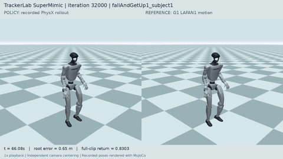
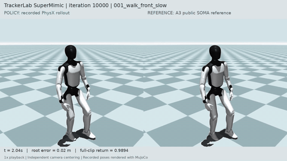

# Policy Demos

Recorded simulation excerpts from the G1, Go2, A3, T1 and Bumi experiments,
refreshed on October 25, 2026. GIF previews loop at **1x speed**; their MP4
versions preserve longer excerpts at 25 fps. All policies ran in
**IsaacLab / PhysX**. MuJoCo renders the recorded poses.

Motion-tracking comparisons place the policy on the left and the reference
on the right. Each camera follows its robot independently, so visual centering
does not remove world-coordinate tracking error from the measurements.

## G1 Motion Tracking

The **32,000-iteration** checkpoint uses 8,096 environments and tracks
G1-retargeted LAFAN1 references. Full evaluation covers all 40 training clips:
**0.8694663** macro normalized return and **0/40** early terminations.

| Dance | Repeated jumps |
| --- | --- |
|  |  |
| [14-second MP4](media/g1_dance_032000.mp4?raw=true) | [14-second MP4](media/g1_jump_032000.mp4?raw=true) |

**Reference-guided falling and getting up**

[16-second MP4](media/g1_getup_032000.mp4?raw=true). This policy follows the
recorded fall-and-get-up trajectory. Recovery from arbitrary falls or external
pushes remains unmeasured.

The excerpts use `dance2_subject1`, `jumps1_subject1` and
`fallAndGetUp1_subject1`. Their full-clip returns are **0.8557**, **0.8670**
and **0.8303** respectively. Original clip start times and output hashes are
recorded in [the media manifest](media/manifest.json).

## Go2 Tasks

These are two separate **10,000-iteration** checkpoints with 8,096 environments:
reference-conditioned trot tracking, and a gait-initialized obstacle task.
The task policy's iteration count excludes its earlier training stages.

| Trot tracking | Autonomous mixed-height passage |
| --- | --- |
|  |  |
| [9-second MP4](media/go2_trot_010000.mp4?raw=true) | [16-second MP4](media/go2_adaptive_010000.mp4?raw=true) |

**Trot:** the Kine2Go-retargeted `ai4_dog_trot_00` training clip scores
**0.9272567**, with **0/1** failed clips. Measured forward speed is **0.8412 m/s**
against **0.8377 m/s** for the reference; root-position RMSE is **0.0607 m**.
The actor consumes reference-motion goals.

**Bar passage:** the adaptive profile uses varying heights and directions
with **1-2 seconds per encounter**, evaluated at difficulty **1.0**.
The policy receives velocity commands and obstacle geometry, with no
jump/duck selection command. Across 16 predefined 16-second trials:

| Measurement | Recorded value |
| --- | ---: |
| Successful attempts, including unfinished final attempts in the denominator | 157/173 (90.75%) |
| Naturally completed attempts | 157/157 successful |
| Unfinished end-of-horizon attempts, counted as failures | 16 |
| Trials surviving the full episode | 16/16 |
| Collision events / falls | 0 / 0 |
| Strict successful sequences, including each unfinished final attempt | 0/16 |
| Body-frame velocity RMSE | 0.5984 m/s |
| Observed successful maneuvers: under / airborne-over / step-over | 71 / 82 / 4 |

The displayed video is **trial 0**, chosen before evaluation outcomes:
10/11 attempts succeed; its final attempt is unfinished at the time limit.
GIFs show shorter excerpts. Maneuver labels are geometric classifications;
the airborne label uses foot-center height, without foot-force confirmation.
Velocity error remains substantial.

## A3 And T1

Both snapshots are **10,000 iterations**, trained from random initialization
with **4,096 environments each**. They share the motion pipeline and learner,
with robot-specific models, joint layouts and task configurations.

| A3 alternating punches | T1 dance |
| --- | --- |
|  |  |
| [12-second MP4](media/a3_punch_010000.mp4?raw=true) | [12-second MP4](media/t1_dance_010000.mp4?raw=true) |

**A3 walking**

[12-second MP4](media/a3_walk_010000.mp4?raw=true).

These excerpts use fresh 10,000-iteration checkpoints with 4,096 environments.

| Training-library evaluation | A3 | T1 |
| --- | ---: | ---: |
| Full-clip macro return at iteration 2,000 | 0.9003 | 0.8100 |
| Full-clip macro return at iteration 4,000 | 0.9764199 | 0.8401361 |
| Full-clip macro return at iteration 10,000 | 0.9844662 | 0.8702665 |
| Failed clips at iteration 10,000 | 0/20 | 0/1 |

A3 completes all 20 clips. At iteration 10,000, its walking clip has root-position
RMSE **0.0652 m** and joint-position RMSE **0.0377 rad**. T1 completes its
**32.68-second** dance evaluation; joint-position RMSE is **0.3171 rad** and
root-position RMSE is **0.1284 m**. The T1 video shows the first 12 seconds.

## Bumi

Bumi's fresh 10,000-iteration policy uses 4,096 environments and the Noetix
Bumi V3 vendor motion `2` (342 source frames, 50 Hz, 21 joints). The complete
6.82-second clip scores **0.9372711**, with **0/1** failed clips. Joint-position
RMSE is **0.08757 rad**, root-position RMSE **0.03188 m**, and root-velocity
RMSE **0.12915 m/s**.

| Vendor-motion tracking |
| --- |
|  |
| [6.84-second MP4](media/bumi_motion_010000.mp4?raw=true) |

The upstream robot-space motion is used with named-joint conversion, hard-limit
projection for 28 elbow samples (maximum adjustment **0.33015 rad**), and body
targets recomputed by the pinned MJCF. This is an evaluation on the one training
clip; held-out motions and hardware performance are unmeasured. The simulation
policy rollout is replayed as poses in MuJoCo for this video.

## Sources And Interpretation

- G1: [G1-retargeted LAFAN1](https://huggingface.co/datasets/lvhaidong/LAFAN1_Retargeting_Dataset),
  based on Ubisoft La Forge's LAFAN1 motions.
- Go2 trot: [Kine2Go](https://huggingface.co/datasets/MIMUW-Robotics/kine2go),
  retargeted from AI4Animation quadruped motion capture. The bar task is trained
  with simulated scenarios after gait initialization.
- A3: [AgibotTech/sonic_for_a3](https://github.com/AgibotTech/sonic_for_a3),
  20 public robot-space motions.
- T1: [BoosterRobotics/booster_assets](https://github.com/BoosterRobotics/booster_assets),
  one public robot-space dance.
- Bumi: [Noetix-Robotics/noetix_bumi_lab](https://github.com/Noetix-Robotics/noetix_bumi_lab),
  one Bumi V3 robot-space motion.

Pinned resource revisions and original attribution are in
[resources.lock.json](../scripts/rls/supermimic/resources.lock.json) and
[NOTICE.md](../NOTICE.md). Media consists of our policy simulation recordings;
robot assets, reference datasets and weights are distributed separately.

Tracking returns use each entire reference duration, with zero reward after
early termination. Data volume and task histories differ across robots.
These measurements cover training libraries and predefined simulation trials;
held-out generalization and hardware performance remain unmeasured.

[manifest.json](media/manifest.json) contains checkpoint hashes, original
evaluation/video hashes, full per-motion or aggregate task measurements,
excerpt timestamps, encoding settings and hashes of every published GIF/MP4.
All source video hashes were checked against delivery manifests. Every output
was fully decoded. Animated previews were checked for motion and reviewed
through sampled frames.
